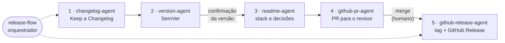

# DocFlow Agents

Skills e agentes de IA que automatizam a **documentação de software no ciclo de release**: changelog, versionamento, README, Pull Request e tag/Release no GitHub. Escritos no formato aberto [Agent Skills](https://agentskills.io), então funcionam em Claude Code, GitHub Copilot, Cursor, Gemini CLI, Codex e em outras ferramentas que leem `SKILL.md`.

## Por que existe

Em muitos times, changelog, versionamento semântico, tags e descrições de PR úteis não são hábito: cada release vira uma arqueologia no `git log`, ninguém sabe qual commit gerou qual versão, e o revisor abre um PR de 40 arquivos sem saber por onde começar. Este projeto transforma essas práticas em um fluxo guiado por IA, com humano no controle das decisões que importam.

## O fluxo



| Skill | Responsabilidade |
|---|---|
| [`release-flow`](.agents/skills/release-flow/SKILL.md) | Orquestra as etapas, guarda o estado em `.release/context.yml` e para nas confirmações. |
| [`changelog-agent`](.agents/skills/changelog-agent/SKILL.md) | Escreve o `CHANGELOG.md` (Keep a Changelog) a partir dos commits; cada item aponta para o PR ou commit de origem, o que torna as mudanças rastreáveis. Gera também changelog retroativo a partir das tags. |
| [`version-agent`](.agents/skills/version-agent/SKILL.md) | Analisa a branch (commits, arquivos removidos, migrations, contratos de API, dependências) e decide MAJOR, MINOR ou PATCH, aplicando regras do usuário. Propõe, justifica com evidências e só edita depois da confirmação. |
| [`readme-agent`](.agents/skills/readme-agent/SKILL.md) | Cria ou atualiza o README com stack, área (back-end, front-end, dados, ML, IA), versões das bibliotecas, SDKs, requisitos e **decisões técnicas com a fonte de cada uma**; sem evidência, escreve "a confirmar" em vez de inventar. |
| [`github-pr-agent`](.agents/skills/github-pr-agent/SKILL.md) | Escreve o PR para o revisor: resumo curto, parte mais complexa em destaque, decisões, impacto, dependências, como testar. Abre o PR com `gh` depois de confirmação. |
| [`github-release-agent`](.agents/skills/github-release-agent/SKILL.md) | Cria a tag anotada e o GitHub Release com `gh`, só depois do merge. Ajuda times sem o hábito: primeira tag e tags retroativas. |

Veja o fluxo rodando num projeto de exemplo, com saídas reais dos scripts: [`examples/walkthrough.md`](examples/walkthrough.md).

## Princípios de design

- **Formato aberto como fonte única.** As skills vivem em `.agents/skills/` e não dependem de uma IDE. Adaptar a uma ferramenta nova é copiar ou linkar a pasta.
- **Julgamento no modelo, fatos em código.** Ler o git, classificar arquivos, comparar dependências e extrair notas do changelog são tarefas determinísticas e ficam em [scripts testados](.agents/skills/release-flow/scripts). Decidir categoria, bump e redação é do agente.
- **Humano nas decisões irreversíveis.** Versão, `git push`, `gh pr create`, tag e Release exigem confirmação explícita. A tag só nasce depois do merge.
- **Verdade antes de fluência.** Nenhuma biblioteca, motivo de decisão ou variável de ambiente é inventada: tudo precisa de evidência no repositório, ou é marcado como "a confirmar" e perguntado.
- **Estado em arquivo.** O contrato `.release/context.yml` permite retomar o fluxo em outra ferramenta ou sessão.
- **Regras do time.** Um `.release-rules.md` opcional ajusta versionamento, changelog, README, PR e tags ao jeito de cada equipe.

Mais detalhes e trade-offs em [`docs/design.md`](docs/design.md) e nos [ADRs](docs/adr).

## Compatibilidade

Verificada nas documentações oficiais em 10/11/2026; confira se algo mudou.

| Ferramenta | Onde lê as skills | Observação |
|---|---|---|
| GitHub Copilot (CLI, cloud agent, revisão de código, agent mode no VS Code) | `.github/skills`, `.claude/skills` ou `.agents/skills` | [Docs](https://docs.github.com/en/copilot/how-tos/use-copilot-agents/cloud-agent/create-skills) |
| Cursor | `.agents/skills`, `.cursor/skills` e, por compatibilidade, `.claude/skills` | [Docs](https://cursor.com/docs/skills.md) |
| Gemini CLI | `.gemini/skills` ou `.agents/skills` | [Docs](https://geminicli.com/docs/cli/skills/) |
| Claude Code | `.claude/skills` | A documentação não cita `.agents/skills`; o instalador cria o link em `.claude/skills`. [Docs](https://code.claude.com/docs/en/skills.md) |
| Codex CLI | `.agents/skills` | Informação de fonte secundária; confirme na documentação da ferramenta. |

O arquivo [`AGENTS.md`](AGENTS.md) descreve o projeto para qualquer agente (o Cursor o lê na raiz e em subpastas); `CLAUDE.md`, `GEMINI.md` e `.github/copilot-instructions.md` apontam para ele.

## Instalação

Requisitos: `git`, [GitHub CLI](https://cli.github.com/) autenticado (`gh auth login`) e, para os scripts de apoio, Python 3.8+. Os scripts são opcionais: cada skill traz o equivalente em comandos git.

```bash
git clone https://github.com/debugdavi/docflow-agents
python docflow-agents/scripts/install.py /caminho/do/seu/projeto     # no projeto
python docflow-agents/scripts/install.py --personal                  # para todos os seus projetos
```

O instalador copia as skills para `.agents/skills/`, cria `.claude/skills/<skill>` como link relativo (ou cópia, onde o sistema não permite links, como o Windows sem modo de desenvolvedor), copia `.release-rules.example.md` e adiciona `.release/` ao `.gitignore`. Rode de novo à vontade: ele não sobrescreve nada sem `--force`.

Para usar as skills **neste** repositório no Claude Code: `python scripts/install.py --here`.

## Uso

Peça em linguagem natural, na ferramenta que você usa:

- *"Prepare a release"*, ativa `release-flow` e conduz o fluxo todo.
- *"Qual deve ser a próxima versão?"*, ativa só o `version-agent`.
- *"Gere o changelog das versões antigas a partir das tags"*, `changelog-agent` em modo retroativo.
- *"Abra um PR para esta branch"*, `github-pr-agent` em modo feature.
- *"Crie a tag e a release da v1.3.0"*, `github-release-agent`, depois do merge.

Em ferramentas com comandos de skill (Claude Code, Cursor), também dá para chamar pelo nome: `/release-flow`.

Para ajustar ao seu time, copie `.release-rules.example.md` para `.release-rules.md` e edite. Exemplos de regras: "enquanto a versão for `0.y.z`, breaking change sobe o MINOR", "migration que remove coluna é MAJOR", "PRs de release sempre como rascunho".

## Estrutura

```text
.agents/skills/
├── release-flow/            orquestrador
│   ├── references/          convenções e contrato de contexto
│   ├── scripts/             collect_commits.py, branch_facts.py, extract_release_notes.py
│   └── assets/              modelo de .release-rules.md
├── changelog-agent/
├── version-agent/
├── readme-agent/            + modelo de README e guia de detecção de stack
├── github-pr-agent/         + modelos de PR (funcionalidade e release)
└── github-release-agent/
docs/                        design, ADRs e referências
examples/                    repositório de exemplo e passo a passo
scripts/                     instalador e validador de skills
tests/                       testes dos scripts (git real em repositórios temporários)
```

## Desenvolvimento

```bash
python scripts/validate_skills.py          # confere as skills contra a especificação Agent Skills
python -m unittest discover -s tests -v    # testa scripts, validador e instalador
```

O workflow [`validate.yml`](.github/workflows/validate.yml) roda os dois a cada push e PR. O validador confere nome, tamanho da descrição, campos permitidos, limite de 500 linhas por `SKILL.md`, links relativos e referências entre skills.

## Limitações

- Skills são instruções para um modelo: o texto gerado varia entre execuções e entre modelos. Os scripts e testes garantem a parte determinística, não a redação.
- O fluxo foi escrito e testado sobre repositórios git reais (veja `tests/`), mas não foi executado de ponta a ponta em todas as ferramentas da tabela de compatibilidade.
- Só GitHub (`gh`). Adaptar para GitLab ou outra plataforma exige trocar as etapas 4 e 5.
- A decisão de versão usa heurísticas sobre a branch. Elas apontam evidências; quem confirma é a pessoa.

## Próximos passos

- Subagente de revisão que confere a coerência final entre changelog, versão, README e PR.
- Avaliações automatizadas (evals) das skills com repositórios de exemplo e saídas esperadas.
- Suporte a monorepo com versões independentes por pacote.
- Empacotamento como plugin para Claude Code e Copilot.

## Referências

Fontes consultadas para o desenho do projeto em [`docs/references.md`](docs/references.md).

## Autor e licença

Davi Lucas Gomes de Araújo ([@debugdavi](https://github.com/debugdavi)). Licença [MIT](LICENSE).
