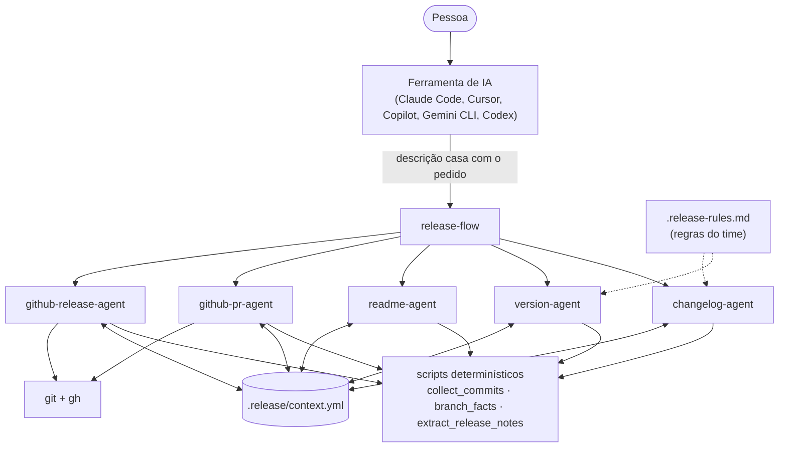

# Design

Como o DocFlow é montado e por quê. As decisões que merecem registro próprio estão nos [ADRs](adr/).

## Problema

Documentar uma release tem cinco tarefas que dependem umas das outras e que, sem hábito, ficam para depois ou saem inconsistentes: changelog, número da versão, README, descrição do PR e tag. O trabalho é repetitivo, mas exige julgamento (o que merece entrar no changelog? isso é MAJOR ou MINOR? qual parte do PR é difícil de revisar?) e envolve ações difíceis de desfazer (publicar tag e Release).

## Objetivos

1. Cada etapa produzir algo útil sozinha e também funcionar encadeada.
2. Funcionar em várias ferramentas de IA, sem reescrever por IDE.
3. Nunca afirmar o que não tem evidência no repositório.
4. Manter a pessoa no controle do que é irreversível.
5. Ser fácil de adotar por um time que não tem nenhuma dessas práticas ainda.

## Por que vários agentes e não um

Cada etapa lê dados diferentes (commits, diff da branch, manifestos, GitHub) e produz saídas de formatos diferentes. Um agente único com seis responsabilidades mistura contextos e erra mais. A regra adotada: **uma skill por tarefa que termina sozinha**, mais uma skill orquestradora que só coordena. Os limites do formato Agent Skills reforçam isso: o corpo de uma skill deve ficar abaixo de 500 linhas e a descrição de cada skill é a única parte sempre carregada, então cada skill precisa ser pequena e ter um gatilho claro.

## Arquitetura

### Camadas

- **Skills (`SKILL.md`):** instruções em linguagem natural, carregadas sob demanda. O mecanismo é a divulgação progressiva do formato: a ferramenta carrega só `name` e `description` de todas as skills; o corpo é lido quando a tarefa casa com a descrição; `references/`, `assets/` e `scripts/` entram só quando necessários.
- **Scripts:** Python com biblioteca padrão. Reúnem fatos do git em JSON e fazem extrações exatas. Não decidem nada.
- **Contexto (`.release/context.yml`):** estado entre as etapas. Cada skill escreve só a própria seção.
- **Regras do time (`.release-rules.md`):** ajustes opcionais que as skills leem e citam na justificativa.

## Divisão entre código e modelo

| Tarefa | Quem faz | Por quê |
|---|---|---|
| Listar commits desde a última tag, ler rodapé `BREAKING CHANGE:`, achar PR citado | script | exato, repetível, testável |
| Classificar arquivos por categoria, diffs de dependências, versões nos manifestos | script | idem |
| Extrair a seção de uma versão do changelog | script | idem |
| Decidir se um commit entra no changelog e em qual seção | modelo | depende de entender o impacto |
| Decidir MAJOR, MINOR ou PATCH | modelo, com evidências do script e regras do usuário | exige julgamento e pode ser corrigido pela pessoa |
| Redigir changelog, README, PR | modelo | é escrita |
| Achar a parte difícil de revisar de um PR | modelo, perguntando à pessoa na dúvida | depende de contexto de negócio |

Os scripts geram **dicas** (por exemplo, "arquivos de código removidos: possível remoção de API pública"), nunca conclusões. A dica manda investigar; quem decide é o agente, e quem confirma é a pessoa.

## Pontos de confirmação

1. **Versão:** depois do `version-agent`, antes de qualquer edição de arquivo. É o número que README, PR e tag herdam.
2. **Push e PR:** o `github-pr-agent` mostra título, branches, rótulos e corpo antes de `git push` e `gh pr create`.
3. **Tag e Release:** só com o PR mergeado, mostrando o commit exato que receberá a tag.

Sem `gh` instalado ou autenticado, o fluxo termina nos textos e comandos prontos para a pessoa executar.

## Honestidade sobre decisões

O `readme-agent` registra o motivo de cada decisão técnica com a fonte (ADR, commit, PR). Para achar a fonte de uma dependência usa `git log -S` no manifesto, que devolve o commit que a introduziu. Sem fonte, a célula diz "a confirmar" e o agente pergunta. O mesmo princípio vale para o PR: alternativas descartadas só aparecem se estiverem registradas ou se a pessoa as disser.

## Testes

- **Scripts:** testes com `unittest` criam repositórios git temporários, fazem commits reais e conferem a saída (breaking por `!` e por rodapé, tag em HEAD, remoção de arquivo, diff de dependências, links de rodapé do changelog).
- **Skills:** o validador confere cada `SKILL.md` contra a especificação (campos, nome, tamanho, links relativos, referências entre skills e a scripts).
- **CI:** o workflow roda validador e testes a cada push e PR.
- **Exemplo:** `examples/make_sample_repo.py` gera um repositório com hashes reproduzíveis, usado no [passo a passo](../examples/walkthrough.md).

## O que não foi feito (e por quê)

- **Evals das skills:** medir a qualidade do texto gerado exige um conjunto de casos com saídas esperadas e critérios de avaliação. Está nos próximos passos; os testes atuais cobrem só o determinístico.
- **Subagentes específicos de uma ferramenta:** o Claude Code permite definir subagentes com ferramentas restritas, o que ajudaria numa revisão final isolada. Ficou de fora para manter o núcleo igual em todas as ferramentas.
- **Servidor MCP:** daria uma interface estruturada às etapas, mas exigiria hospedar e instalar um processo. Skills e scripts cobrem o caso com menos peso.
- **GitLab:** o projeto nasceu pensando em GitLab e foi migrado para `gh`. Voltar a suportar GitLab é trocar as etapas 4 e 5.
